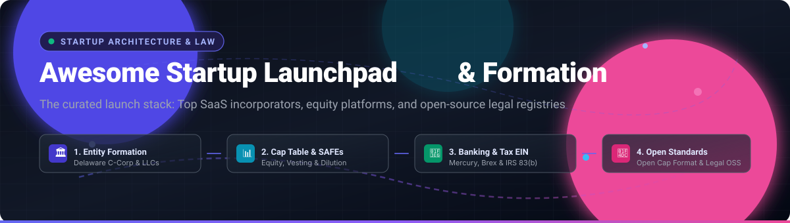

# Awesome Startup Launchpad & Business Formation 🚀🏛️

  

  
  
  
  
  
  

> 💡 **A definitive, SEO-optimized guide and curated catalog of top Startup Launchpads, Delaware C-Corp & LLC Business Formation Platforms, Venture Cap Table Tools, and Open-Source Legal Infrastructure.**
> 🌟 *Star this repository if you find it helpful for your founder journey!* 🌟

---

## 📑 Table of Contents
- [🌐 Sector Overview & Market Dynamics](#-sector-overview--market-dynamics)
- [🏢 SaaS & Hosted Commercial Platforms](#-saas--hosted-commercial-platforms)
- [💻 Open-Source Software & Tooling](#-open-source-software--tooling)
- [⚖️ Feature & Architecture Comparison](#️-feature--architecture-comparison)
- [🤝 Contributing](#-contributing)
- [📜 License](#-license)

---

## 🌐 Sector Overview & Market Dynamics

The global legal services and corporate entity management market represents an estimated **$1.10 trillion to $1.15 trillion** industry, expanding at a CAGR of ~4.6% toward $1.35 trillion. Within this ecosystem, the business formation and startup launchpad sector is **highly fragmented**, populated by three competing tiers: high-volume digital self-service platforms (e.g., LegalZoom, ZenBusiness), venture-grade incorporation infrastructure (e.g., Stripe Atlas, Clerky), and tens of thousands of localized corporate attorneys and CPAs. 

Rather than a "winner-take-all" monopoly, market dynamics reflect strong structural segmentation. High-volume consumer LLC filings operate with low margins and fierce customer-acquisition battles, while venture-backed Delaware C-Corps demand rigorous legal document compliance (standardized YC SAFE documents, 83(b) tax elections, and equity vesting), preventing any single platform from completely capturing both ends of the formation spectrum.

---

## 🏢 SaaS & Hosted Commercial Platforms

Below is the comparative breakdown of the top commercial business formation and startup launchpad providers, sorted in descending order by company scale (valuation / annual revenue).

| Platform | Scale (Valuation / Revenue) | Starting Pricing (Specific Tier) | Free Tier Limits / Free Trial | Best Suited For | Core Capabilities |
| :--- | :--- | :--- | :--- | :--- | :--- |
| [**Stripe Atlas**](https://stripe.com/atlas) | **~$70B+ Valuation** (~$4B+ Net Revenue) | **$500 one-time** (Delaware C-Corp filing & setup) + $100/yr registered agent renewal after Year 1 | **Free to apply**; no free formation filing plan. Includes up to $25,000 fee-free Stripe processing credits and partner perks | Venture-track US & global founders | Delaware C-Corp filing, Orrick legal paperwork, remote IRS EIN, stock issuance, integrated Mercury/Brex bank accounts |
| [**ZenBusiness**](https://www.zenbusiness.com/) | **$1.7B Valuation** (~$82M+ ARR) | **$0 + State Filing Fees** (Starter Plan) / $199/yr + State Fees (Pro Plan) | **Free forever Starter Plan**: $0 service fee + mandatory state fees (standard filing speed, name availability check, phone support, virtual dashboard) | Solopreneurs, domestic US LLCs & small businesses | LLC/Corp formation, registered agent services, Worry-Free Compliance, annual reports, business banking referrals |
| [**LegalZoom**](https://www.legalzoom.com/) | **~$1.0B Market Cap** (~$750M Annual Revenue) | **$0 + State Filing Fees** (Basic Formation) / $249 + State Fees (Pro Plan) / $299 + State Fees (Premium) | **Free forever Basic Plan**: $0 service fee + mandatory state fees (Articles of Organization preparation & filing, digital welcome packet, name search) | Main street small business owners & general legal needs | Comprehensive business formation, trademark registration, operating agreements, contracts, network attorney consultations |
| [**Firstbase**](https://www.firstbase.io/) | **~$65M+ Raised** (~$15M+ ARR) | **$399 one-time** (Firstbase Start) + state filing fees | **No free tier**; no free trial for incorporation. Provides access to Firstbase Loop rewards ($350k+ in discounts across AWS, Notion, Mercury) | Non-US residents and remote venture founders | Delaware & Wyoming LLC/C-Corp creation, fast EIN retrieval, registered agent, Mailroom virtual address, compliance add-ons |
| [**doola**](https://www.doola.com/) | **~$40M Valuation** (~$5M+ ARR) | **$297/year** (Starter Formation Plan) + state filing fees | **No permanent free tier** for formation; offers a **30-day free trial** for its standalone bookkeeping & financial dashboard software | Global solo founders, digital nomads & e-commerce sellers | Cross-border company registration, US EIN acquisition, registered agent, US bank account assistance, annual IRS tax filings |
| [**Clerky**](https://www.clerky.com/) | **Acquired by Stripe** (Bootstrapped / Profitable) | **$427 one-time** (Pay-Per-Use Formation) or **$819 one-time** (Company Lifetime Formation Package) | **No free tier or trial**; every legal workflow is strictly pay-per-use or lifetime bundled upfront | Y Combinator & top-tier venture track startups | Industry-standard YC document stack, Delaware C-Corp formation, post-incorporation setup, stock plans, convertible notes, SAFEs |

---

## 💻 Open-Source Software & Tooling

While legal business formation inherently requires filing with official state registries and municipal databases, the open-source software ecosystem offers critical infrastructure for **open capitalization standards**, **cap table modeling**, **legal document structuring**, and **public entity registration frontends**.

Listed below are top open-source projects, equipped with live social badges linking to their respective stargazer pages, sorted in descending order by GitHub star count:

### 1. [General-Legal/legal-templates](https://github.com/General-Legal/legal-templates) 
* **Stars:** 3,600+ ⭐ | **License:** CC0-1.0 | **Stack:** Markdown / Legal Templates
* **Description:** A comprehensive, attorney-drafted public collection of high-quality legal templates published under the CC0 public domain license. It includes early-stage founder incorporation documents, founder IP assignment agreements, non-disclosure agreements (NDAs), advisory agreements, and consulting contracts.
* **Why it stands out:** Offers transparent legal boilerplate that eliminates expensive legal retainer costs for standard pre-incorporation agreements.

### 2. [Open-Cap-Table-Coalition/Open-Cap-Format-OCF](https://github.com/Open-Cap-Table-Coalition/Open-Cap-Format-OCF) 
* **Stars:** 195+ ⭐ | **License:** Apache-2.0 | **Stack:** JSON Schema / TypeScript
* **Description:** The Open Cap Format (OCF) is an open-source data standard initiated by leading legal firms, software providers, and venture funds to structure and exchange capitalization data seamlessly across equity platforms without vendor lock-in.
* **Why it stands out:** Governs share classes, vesting schedules, stock options, and convertible instruments (SAFEs), making cap table records interoperable between legal counsel and platforms like Carta, Pulley, and AngelList.

### 3. [1984vc/cap-table](https://github.com/1984vc/cap-table) 
* **Stars:** 143+ ⭐ | **License:** Open Source | **Stack:** Spreadsheet / Financial Models
* **Description:** An open-source capitalization table modeling worksheet developed by venture capital firm 1984 Ventures. Enables early-stage founders to run scenario planning, pro-forma share issuances, option pool expansions, and priced equity funding rounds.
* **Why it stands out:** Transparent mathematical formulas for pre-money and post-money SAFE conversions with round-by-round dilution visibility.

### 4. [Open-Cap-Stack/opencap](https://github.com/Open-Cap-Stack/opencap) 
* **Stars:** 25+ ⭐ | **License:** MIT | **Stack:** TypeScript / Next.js / Node.js
* **Description:** An open-source cap table and equity management platform built as a self-hosted alternative to Carta and Pulley for venture-backed startups and growing teams.
* **Why it stands out:** Provides stakeholder tracking, stock grant issuances, and exercise management with zero SaaS recurring seat fees.

### 5. [TBI-AI-Incubator/codify](https://github.com/TBI-AI-Incubator/codify) 
* **Stars:** 14+ ⭐ | **License:** Apache-2.0 | **Stack:** Python / Akoma Ntoso XML / REST API
* **Description:** Legal document structuring engine that converts unstructured legal documents (PDFs, text agreements, charters) into machine-readable Akoma Ntoso XML, anchoring sections, clauses, and corporate definitions.
* **Why it stands out:** Excellent for analyzing certificates of incorporation, corporate bylaws, and operating agreements programmatically.

### 6. [bcgov/business-filings-ui](https://github.com/bcgov/business-filings-ui) 
* **Stars:** 12+ ⭐ | **License:** Apache-2.0 | **Stack:** Vue.js / TypeScript
* **Description:** Official open-source digital registry interface developed by BC Registry Services (Government of British Columbia) for business maintenance, corporate filings, and compliance tracking.
* **Why it stands out:** Production-grade blueprint demonstrating how modern state and provincial governments implement digital business incorporation portals.

### 7. [bcgov/business-create-ui](https://github.com/bcgov/business-create-ui) 
* **Stars:** 11+ ⭐ | **License:** Apache-2.0 | **Stack:** TypeScript / Vue.js
* **Description:** Production incorporation application frontend built by the British Columbia government to handle step-by-step entity formation, officer declarations, and registry submissions.
* **Why it stands out:** Full-fledged open-source reference for step-by-step legal entity formation wizards and public registry integration.

### 8. [acossta/captan](https://github.com/acossta/captan) 
* **Stars:** 3+ ⭐ | **License:** Open Source | **Stack:** Node.js / CLI / Git
* **Description:** A minimalist, developer-first command-line tool for managing startup cap tables using a single version-controlled JSON file and Git history — requiring zero database infrastructure.
* **Why it stands out:** Supports vesting schedules, SAFE conversions, and CSV investor exports completely within a local Git repository.

### 9. [kosmitor/kosmitor](https://github.com/kosmitor/kosmitor) 
* **Stars:** 2+ ⭐ | **License:** Open Source | **Stack:** TypeScript / React / PostgreSQL
* **Description:** Full-stack open-source cap table and equity platform covering equity grants, vesting cliffs, priced-round modeling, waterfall exits, and US compliance calculations (Rule 701, 83(b), 409A).
* **Why it stands out:** Includes 24 user interface screens and a standalone, dependency-free math engine for verified financial precision.

---

## ⚖️ Feature & Architecture Comparison

| Platform / Tool | Type | License | Entity Filing | Cap Table Engine | Self-Hosted | Venture Ready |
| :--- | :--- | :--- | :--- | :--- | :--- | :--- |
| **Stripe Atlas** | SaaS | Proprietary | ✅ (Delaware C-Corp) | ❌ | ❌ | 🌟 High (Top tier) |
| **ZenBusiness** | SaaS | Proprietary | ✅ (50 US States) | ❌ | ❌ | 🟡 Moderate (LLC/SMB focus) |
| **LegalZoom** | SaaS | Proprietary | ✅ (50 US States) | ❌ | ❌ | 🟡 Moderate (General legal) |
| **Firstbase** | SaaS | Proprietary | ✅ (DE / WY) | ❌ | ❌ | 🟢 High (Remote/International) |
| **doola** | SaaS | Proprietary | ✅ (50 US States) | ❌ | ❌ | 🟡 Moderate (Non-US solopreneurs) |
| **Clerky** | SaaS | Proprietary | ✅ (Delaware C-Corp) | 📄 (Docs) | ❌ | 🌟 High (YC Standard) |
| **General-Legal Templates** | OSS | CC0-1.0 | 📄 (Doc Kit) | ❌ | ✅ | 🟢 High (Attorney drafted) |
| **Open Cap Format (OCF)** | OSS | Apache-2.0 | ❌ | 📐 Standard | ✅ | 🌟 High (Industry standard) |
| **1984vc Cap Table** | OSS | Open Source | ❌ | 📊 Model | ✅ (Local) | 🟢 High (Venture modeled) |
| **OpenCap** | OSS | MIT | ❌ | ✅ Full | ✅ | 🟢 High (Carta alternative) |
| **Codify Core** | OSS | Apache-2.0 | ❌ (Doc XML) | ❌ | ✅ | 🟡 LegalTech tooling |
| **BC Registry Services** | OSS | Apache-2.0 | ✅ (BC Registry) | ❌ | ✅ (Reference) | 🏛️ Government standard |
| **Captan** | OSS | Open Source | ❌ | ✅ CLI | ✅ (Git-local) | 🟢 Technical founders |
| **Kosmitor** | OSS | Open Source | ❌ | ✅ Full | ✅ | 🟢 High (Self-hosted equity) |

---

## 🤝 Contributing

Contributions are welcomed and encouraged! If you know of an active open-source project or developer tool in the startup formation, equity management, or legal tech space, please feel free to contribute:

1. 🍴 Fork the repository.
2. 🌿 Create your feature branch (`git checkout -b feature/cool-new-tool`).
3. 📝 Add your item adhering to the existing formatting and table standards.
4. 🚀 Commit your changes (`git commit -m 'Add new open-source cap table tool'`).
5. 📤 Push to the branch (`git push origin feature/cool-new-tool`).
6. 📬 Open a Pull Request!

---

## 📜 License

Distributed under the **CC0 1.0 Universal (Public Domain Dedication)**. You are free to copy, modify, and distribute this work without asking for permission.

---

  ⭐ <b>If you find this startup launchpad curated list useful, please star the repository!</b> ⭐

